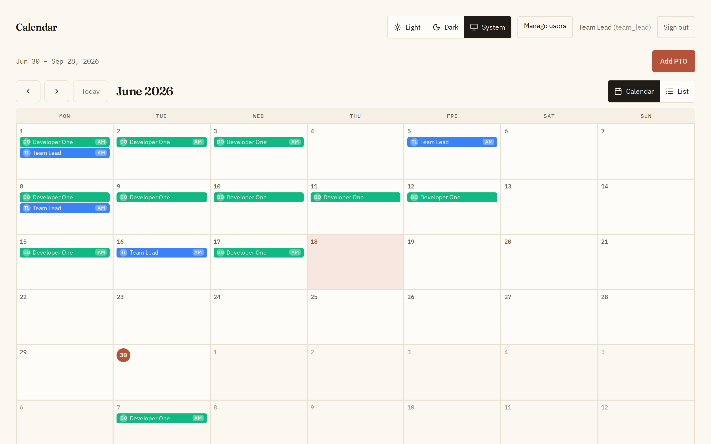
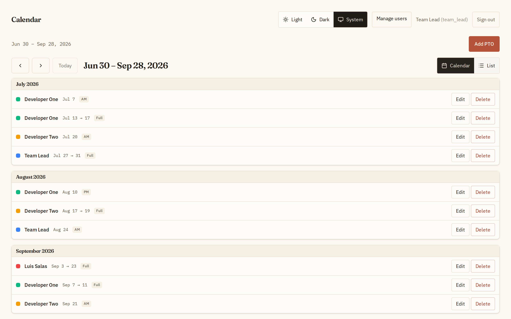

# PTO / Vacation Calendar App Documentation

This repository contains planning and technical documentation for a small internal PTO/vacation calendar app for a development team.

## Repository Layout

```
pto-calendar/
├── backend/     # Node.js + Express + TypeScript + Prisma + PostgreSQL
├── frontend/    # React + TypeScript (Vite) + Tailwind CSS
├── packages/
│   └── api-client/  # Shared typed HTTP client for the REST API (#259)
└── docs/        # Project documentation (see below)
```

## Documents

All project documentation lives under [`docs/`](docs/).

### 1. Product Plan

- **File:** `docs/plan.md`
- **Purpose:** High-level product plan covering goals, users, requirements, UX, technical recommendations, implementation phases, and success criteria.

### 2. Technical Specification

- **File:** `docs/technical-spec.md`
- **Purpose:** Detailed technical design including architecture, domain model, database structure, API behavior, frontend/backend responsibilities, validation rules, and testing guidance.

### 3. Database Schema

- **File:** `docs/schema.sql`
- **Purpose:** SQL schema for the initial relational database setup, including users, PTO requests, indexes, and audit logs.

### 4. OpenAPI Specification

- **File:** `docs/openapi.yaml`
- **Purpose:** API contract for authentication and PTO endpoints, including request/response models and error structures.

### 5. Backlog

- **File:** `docs/backlog.md`
- **Purpose:** Epics, user stories, acceptance criteria, tasks, sprint suggestions, and definition of done.

### 6. Testing & Automation Strategy

- **File:** `docs/testing-strategy.md`
- **Purpose:** Tooling matrix, test pyramid, coverage targets (≥80% on critical services, ≥90% on `PTOService`, 100% on authorization, validation, schemas, middleware, and lifecycle), GitHub Actions CI pipeline, ephemeral Postgres for integration tests, Playwright E2E scope (desktop + mobile-chrome projects), pre-commit hooks, and merge policy.
- **Image policy:** [Temporary risk acceptance (#273)](docs/image-risk-acceptance.md) expires 2026-12-15; accepted risk, **not remediation**. Permanent #247 remains open at high priority.

### 7. Deployment and Backup Runbooks

- **Files:** `docs/deploy.md` and `docs/database-backups.md`
- **Purpose:** OCI VM deployment and recovery, OCI Object Storage
  backups, and encrypted backup/restore procedures.

OCI is the only supported production target. The previous deployment workflows
and runbooks are retired; Git history retains them. This repository cleanup
does not delete old cloud resources or change the existing Firebase-to-OCI redirect.

The comment-triggered `.github/workflows/opencode.yml` workflow requires a
trusted repository owner/member comment and the protected `opencode` GitHub
environment. Keep that environment approval-gated and store
`OPENCODE_API_KEY` as an environment secret, not an unrestricted repository
secret.

### 8. AI Agent Access Assessment

- **File:** [`docs/ai-agent-access-report.html`](docs/ai-agent-access-report.html)
- **Purpose:** Repository findings and proposed requirements for CLI/MCP PTO
  access, self-service personal access tokens (maximum 365 days), permissions,
  agent safety, and phased delivery. Open the HTML in a browser; this is a
  proposal, not an implemented feature. The original 12 November 2026 snapshot
  is preserved; its delivery addendum links to the approved plan below.

### 9. Approved Agent Access Delivery Plan / ADR

- **File:** [`docs/agent-access-delivery-plan.md`](docs/agent-access-delivery-plan.md)
- **Purpose:** Approved scope/security/API/compatibility contracts, complete
  backlog-first ordering, dependency-aware parallel waves and release gates for
  [#246](https://github.com/lhsalas/pto-calendar/issues/246). Both CLI and local
  stdio MCP are planned; neither is shipped by this documentation. All 11
  pre-existing issues must be delivered before new feature implementation.

## Functional Summary

The app is intended to support:

- Authenticated access only
- Session-only personal-token management: all three roles manage their own credentials through `GET/POST /auth/tokens`, `DELETE /auth/tokens/:id` and `POST /auth/tokens/revoke-all`. Issuance verifies the current password every time, shares the failed-auth limiter, defaults to read-only/90 days and enforces the 365-day/ten-active-token limits. Responses are `no-store`; the raw token appears only in the 201 issuance response. Bearer/mixed credentials cannot manage tokens.
- Scoped bearer REST (#251): only explicit PTO methods and safe `GET /auth/me` accept cookie-free PATs when `PAT_AUTH_ENABLED=true`. `PAT_WRITES_ENABLED=true` is a separate write gate; **both flags default false in every environment and remain off for production**. Scopes, live role and record ownership must all pass, including legacy PUT; self-only lead tokens cannot edit colleagues. Notes need explicit note-read permission plus record authority on detail/create/PUT; list notes remain null. Invalid, duplicate or mixed credentials never fall back to cookies. The all-role own-token settings UI (#254) is implemented on the current branch; CLI/MCP clients, the remaining client stories and the separate pilot gates remain outstanding—not production readiness or rollout authorization.
- Own personal access tokens (#254, implemented on the current branch): `/settings/tokens` is an ordinary account page — an **API access** entry in the calendar header, the normal signed-in-user protection and no admin or team-lead gate — where every member, team lead and administrator manages **only their own** tokens. Issuance asks for the current password (verified on the server; never stored, logged or echoed), defaults to read-only scopes and a 90-day lifetime with 30/90/180/365 offered, and shows the raw secret exactly once in a copy-once dialog with explicit loss-and-replacement guidance. The secret stays in component memory, is cleared on close/navigation/unmount, and is never written to `localStorage` or configured through a `VITE_*` variable. The list shows owned metadata only — name, prefix, scopes, created/expiry/last-used, the server-computed absolute expiry with the reader's time zone, and the Active/Expired/Revoked/Invalidated status — plus a near-expiry warning; an existing secret is never revealed. Revoke-one and revoke-all use confirmation dialogs that need a valid session but no password, and signing out stays a separate action that does not revoke tokens. The CLI/local MCP section is placeholder-only: nothing is distributed yet, so there is nothing to install and nothing to paste, and it explains that an assistant can see whatever the tool sends it — including note text — and that this reaches the configured AI provider, so a token is never pasted into a chat.
- Credential-attributed audit trail (#252): PTO create/update/delete and the personal-token lifecycle write their audit row in the **same transaction** as the mutation, so a denied, invalid or rolled-back change leaves no committed success record. Each row carries the actor, the credential type (`session`, `personal_access_token`, `setup_token`, `operator`), the source public token ID where one applies, the target owner, the timestamp and the safe correlation ID. Attribution comes only from verified server state; client labels and user-agent strings are not identity. Audit rows never contain note text, raw tokens, digests or passwords, and they survive token revocation and credential deletion. The trail stays internal: no audit browsing endpoint or UI is added.
- Team member and team lead roles
- PTO CRUD operations
- Single-day PTO with `morning`, `evening`, or `all_day`
- Multi-day PTO across date ranges
- PTO form auto-syncs the end date to the start date on every start-date change; the end-date input has `min={startDate}` so the browser's date picker prevents picking an end date before the start
- In grid view, opening the create modal pre-fills the start date with the 1st of the **viewed future month** (or today for the current/past month); list view always pre-fills with today
- In grid view, clicking a weekday cell (Mon–Fri, including adjacent-month cells) opens the create modal pre-filled with that day; weekend cells are non-interactive; chips inside cells open the view modal without bubbling to the cell handler
- Shared monthly calendar view
- Month navigation (prev/next + a "Today" button to jump back to the current month; the Today button is disabled while the calendar is already on the current month; today's cell is highlighted with a filled blue circle on the day number)
- A "Calendar | List" view toggle: in list mode the app shows all PTOs from today through today + 90 days, grouped by month and sorted ascending, with a "Next" / "Today" / "Previous" shift control that moves the 90-day window
- Color-coded PTO visibility by person
- Edit/delete permissions restricted to owner or team lead
- Light / Dark / System theme toggle (persisted in `localStorage`; default is System and follows `prefers-color-scheme`; no flash of incorrect theme on load)
- Self-hosted typography (IBM Plex Sans body, Fraunces display, IBM Plex Mono for tabular dates) and a Tailwind v4 `@theme` block with the warm-editorial palette tokens defined (consumed in PR C); `lucide-react` icon set re-exported from `src/components/icons.tsx`; `motion` package installed for upcoming animations
- Responsive layout (page padding shrinks on phones, top header wraps, grid scrolls horizontally only inside its own container with a sticky weekday header); all primary interactive elements meet ≥44px tap targets (44px on buttons, 36px on destructive confirm pair); modals (Add/Edit PTO + PTO details) support Escape-to-close, backdrop-click-to-close, body-scroll-lock, and focus trapping with auto-focus of the first focusable element. The shared a11y logic is encapsulated in `frontend/src/hooks/useModalA11y.ts` (generic over the modal root element) and unit-tested at 100% (`useModalA11y.test.tsx`, 8 tests).
- Editorial / paper-planner visual identity: warm cream surface (#FBF8F1), terracotta accent (#B5533A), Fraunces serif for the month label and login h1, IBM Plex Sans for body UI, IBM Plex Mono with tabular-nums for every date display; raw ISO date strings are formatted via `Intl.DateTimeFormat`; loading state is an `aria-busy` skeleton; modals fade-and-slide in via `motion`. Design tokens (palette, typography, radii, motion) are defined once in a Tailwind v4 `@theme` block in `frontend/src/index.css` and consumed by every component.
- Toast notifications for save/update/delete/load-error feedback: a unified `Toast` + `ToastViewport` + `ToastProvider` + `useToast` system mounted in `App.tsx`. Success and error tones, terracotta or danger left-stripe on a `surface-3` card, `CheckCircle2` / `XCircle` lucide icons, slide+fade enter/exit via `motion`, hairline progress bar (pauses on hover/focus, resumes on leave), manual close button, `Escape` dismisses the topmost when the viewport has focus, error toasts move focus to the close button for SR/keyboard users, `prefers-reduced-motion` honored, queue capped at 3 with oldest auto-evicted, and same `tone+title` toasts dedupe in place. `error` toasts from `usePtoList` carry a Retry action that calls `refetch()`.
- Persistent keyboard focus indicators: every input and `<button>` carries a `focus:ring-2` (inputs) or `focus-visible:ring-2 ring-accent-500` (buttons) so the keyboard user always sees where focus lives; ring offset matches the page surface so it reads as part of the layout; chips, calendar cells, modal ×, list-row opens, and Retry link all participate
- Tab favicon: a single 723-byte SVG under `frontend/public/favicon.svg` — calendar-grid mark (rounded-rect page outline, two binding stubs, header divider, 3×3 day grid, one filled "today" square) — single mid-tone terracotta (#B5533A) fill, tab-only, no PNG/apple-touch-icon/manifest/OG
- Production hardening (backend): `helmet` mounted globally for the canonical security headers (CSP, HSTS, `X-Frame-Options: SAMEORIGIN`, `X-Content-Type-Options: nosniff`, `Referrer-Policy: no-referrer`, COOP/CORP/OAC); exact-origin CSRF checks for state-changing split-origin requests; stricter login limiter on `POST /auth/login` (5 failed attempts per 15 min per IP, `skipSuccessfulRequests: true`); broader global limiter across the rest of the API (100 requests per 15 min per IP); both respond with `{ error: { code: 'RATE_LIMITED', message } }` and `Retry-After`. All three limits are env-driven (`RATE_LIMIT_WINDOW_MS`, `RATE_LIMIT_MAX`, `AUTH_RATE_LIMIT_MAX`); defaults are conservative for production but the dev `.env` and CI bump them so e2e suites don't trip the limiter.
- Personal-token quotas (backend, #253): the shared IP high-water above stays as the emergency safety net, and the per-caller budgets are charged against a **verified** identity. A failed bearer verification is charged **before** the credential lookup (`RATE_LIMIT_BEARER_FAILURE_MAX`, default 20 per `RATE_LIMIT_ATTEMPT_WINDOW_MS` per client address) and refunded as soon as the secret verifies, so a flood of invalid tokens stops at the database boundary while a legitimate client behind a shared office address keeps its budget. Every authenticated request is charged once against the verified user (`RATE_LIMIT_USER_QUOTA_MAX`, default 600 per `RATE_LIMIT_QUOTA_WINDOW_MS`) and, for a personal token, against the verified token (`RATE_LIMIT_TOKEN_QUOTA_MAX`, default 300 per window). Token creation (`RATE_LIMIT_TOKEN_ISSUANCE_MAX`, default 20 per attempt window per owner) and the issuance password check (`RATE_LIMIT_TOKEN_PASSWORD_MAX`, default 20 per attempt window per owner) are separate controls that never consume the browser login budget; the password budget is charged before the bcrypt comparison and is not given back, so it bounds the expensive comparisons themselves. Unverified `Authorization` headers are never an identity — not even hashed — and a shared store failure fails closed instead of running unmetered. All counters live in the same production Redis deployment under their own namespaces (`pto:rate-limit:bearer-failure:`, `pto:rate-limit:quota-user:`, `pto:rate-limit:quota-token:`, `pto:rate-limit:token-issuance:`, `pto:rate-limit:token-password:`), so every instance of the API shares one budget. **The shared address high-water still binds first with the conservative defaults** (100 requests per 15 min per address), so an office behind one address keeps sharing that ceiling until an operator raises `RATE_LIMIT_MAX`; every limiter value is an operator override in the Compose files, and nothing is raised automatically.
- Graceful shutdown (backend): SIGTERM/SIGINT drains HTTP requests, awaits `app.closeResources()` for the application-owned native token pool, then disconnects the global Prisma client. `SHUTDOWN_TIMEOUT_MS` (default 10s) force-exits 1 if drain hangs; resource-cleanup failure also exits nonzero. Idle keep-alives are closed during drain, and uncaught exceptions/unhandled rejections remain fatal. `backend/src/lib/lifecycle.ts` has direct unit tests; its documented 100% target still has no configured coverage floor.
- Health vs readiness (backend): `GET /health` is a no-DB liveness probe that always returns 200 + `{ status: 'ok' }` so orchestrators can restart hung instances; `GET /ready` runs `prisma.$queryRaw\`SELECT 1\``with a`READY_TIMEOUT_MS`(default 5s) race-timer and returns 200 +`{ status: 'ready', db: 'ok', uptime }`on success or 503 +`{ error: { code: 'NOT_READY', ... } }`on failure or timeout. Both endpoints are unauthenticated and registered before`authRouter`/`ptoRouter`. Extracted to `backend/src/routes/health.ts`; covered by `server.test.ts` (7 tests including DB-throw and DB-hang cases).
- Request logging (backend): `pino-http` mounted globally between `express.json` and `cookieSession` so request-scoped logs are available everywhere. Every response echoes an `X-Request-Id` header (UUID v4 generated by `crypto.randomUUID()`, or the inbound `X-Request-Id` if the client sent one and it matches the safe character class — values containing control characters or whitespace are replaced with a fresh UUID to prevent log injection). Every non-probe request produces exactly one structured log line with `req.{id,method,url}`, `res.statusCode`, and `responseTime` on response finish; `/health` and `/ready` are skipped via `autoLogging.ignore` so probes don't spam logs. `errorHandler` middleware logs `reqId` with any unhandled error so operators can correlate. The base `pino` logger applies a `redact` configuration that strips `Cookie`, `Set-Cookie`, `Authorization`, and `password`/`passwordHash`/`token`/`secret` fields from every log line, and the custom `req`/`res` serializers drop the `headers` field entirely so session cookies and other auth headers never reach stdout.
- Authorization centralization (backend): the `GET /pto/:id` route uses the shared `canViewNote(actor, pto)` helper from `services/authorization/AuthorizationService` (which delegates to `canModifyPTO`) to decide whether to redact the `note` field. There is no longer a route-local `isOwnerOrLead` helper — all note-visibility logic flows through the authorization service.
- Complete PTO queries (backend, #255): `GET /pto` accepts a validated `userId` filter and opt-in `format=page` with a signed continuation cursor. Browser callers keep the existing array and its 1,000-row cap; paged clients can read past it. Neither list form exposes notes. See the [OpenAPI contract](./docs/openapi.yaml) for limits and concurrency behavior.
- Versioned PTO writes (#256, implemented in this change): every PTO record carries a positive integer `version` that starts at 1 and increments with each successful write; it is returned by the detail, the create/update responses and the opt-in paged items, while the historical capped array keeps its shape and carries no version. `PUT`, `PATCH` and `DELETE` on `/pto/:id` require exactly one canonical quoted strong `If-Match` value that states the expected version (`"1"`, `"2"`, …) for browser and personal-token writes alike: a missing precondition is `428 PRECONDITION_REQUIRED`, a malformed, listed, wildcard, weak or unquoted value is `400 VALIDATION_ERROR`, and an outdated value is `412 STALE_WRITE` with the stored record untouched and no silent retry. An overlapping PTO stays `409 CONFLICT` — a failed precondition is never reported as a business conflict. The version check, the write, the increment and the audit row run in one transaction, so two updates based on one version cannot both succeed and a stale delete cannot remove a newer revision. `PATCH /pto/:id` changes only the fields it carries (omitted keys preserve the stored value, `note: null` and `note: ""` clear it) and validates the merged record with the current rules; the legacy `PUT` note contract, the owner-only rule and the note journeys are unchanged, and the owner can never be transferred. The browser states the version it loaded, surfaces a stale write as a deliberate conflict and recovers by refetching instead of overwriting; an older client without the precondition receives `428` and must refresh. Overlap integrity across rows stays #257 and replay/idempotency stays #258. See the [OpenAPI contract](./docs/openapi.yaml) for the exact header grammar and statuses.
- Atomic PTO non-overlap (#257, implemented in this change): the inclusive owner/date non-overlap invariant is enforced by a PostgreSQL exclusion constraint (`pto_requests_no_owner_overlap`) over the owner and an inclusive `daterange`, backed by the trusted `btree_gist` extension. It therefore holds for concurrent writes and for every credential type — browser session, personal token and future adapter — instead of relying on a preflight `SELECT`. Two half-day entries of one owner on the same date still conflict, different owners may overlap, and weekends inside a continuous range stay allowed. A violation is the same safe `409 CONFLICT` envelope; no raw driver error reaches the client, and the #256 preconditions and the transactional audit rows are unchanged. The migration preflights the existing rows and stops with a sanitized, actionable report when overlaps already exist: it never deletes or rewrites PTO, and the remediation is an explicit operator decision. The repository backup adds the `btree_gist` declaration to the schema dump only when the source database already has the extension — an older, pre-migration database keeps backing up unchanged — and fails closed, uploading nothing, when the produced dump carries the constraint without the extension. Encryption, upload authentication, target confirmation and secret handling are untouched. See [`docs/deploy.md`](docs/deploy.md) §5 for the migration privileges and the safe backup/rollback runbook.
- Safe keyed creates (#258): PAT `POST /pto` requests require an `Idempotency-Key`; cookie clients can still omit it. Within the key's 24-hour lifetime, repeating the same approved payload with the same credential returns the original successful result, without another write or audit. Replay rechecks current access and note visibility. When a key expires or authority changes, reconcile the request instead of automatically creating under a new key. See the [OpenAPI contract](./docs/openapi.yaml).
- Shared Zod validation (backend): Zod schemas are defined once per domain — `backend/src/services/pto/schemas.ts` (`CreatePtoSchema`, `RangeQuerySchema`, `IdParamSchema`, `DayPartSchema`, `ISO_DATE`) and `backend/src/services/auth/schemas.ts` (`LoginSchema`). Both route files import from these and infer their request types directly, so there are no `as` casts or duplicated validation rules. `validation.ts` re-uses `ISO_DATE` and `CreatePtoInput` from the same source. Both schema modules are unit-tested at 100% coverage (4 + 11 tests).
- Middleware direct unit coverage (backend): `cookieSession.ts`, `errorHandler.ts`, and `requireAuth.ts` each have a dedicated unit suite (5 + 5 + 4 tests, 100% on `requireAuth`, 80% on `cookieSession`/`errorHandler`). The middleware layer is no longer covered only via the server-level integration tests.
- `PTOService` direct unit coverage (backend): the create-path and overlap-check helpers (`createPto`, `findOverlapping`) now have direct unit tests (10 new tests in `PTOService.test.ts`), pushing the per-file threshold from 80% to **90% lines/statements/functions** (branches remain at 80% due to a small uncovered defensive branch in the update path).
- Playwright project split (frontend): `frontend/playwright.config.ts` runs two projects — a desktop `chromium` (all `e2e/*.spec.ts`) and a `mobile-chrome` project (Pixel 5) whose `testMatch` is whitelisted to `e2e/mobile-smoke.spec.ts`, `e2e/focus-rings.spec.ts`, and `e2e/smoke.spec.ts` only. The whitelist keeps the mobile run from racing against desktop tests that share the dev `pto` database. `workers=1` in CI.
- Own-token settings E2E (frontend, #254): `frontend/e2e/token-settings.spec.ts` runs the member journey in the desktop `chromium` project only — issue, copy-once, revoke-one and revoke-all on disposable accounts, plus a cookie-free bearer probe of `GET /auth/me` (200 before revocation, 401 after), the keyboard/focus path and the dark theme at a narrow viewport. Each test creates and removes its own randomized member account and token rows, and the spec refuses to run against anything but the designated local `pto`/`pto_test` database and a loopback API.

## Screenshots

The two calendar surfaces, captured from the running dev stack at 1440×900 in light mode:

| Grid view (month)                                                      | List view (next 90 days)                                               |
| ---------------------------------------------------------------------- | ---------------------------------------------------------------------- |
|  |  |

## Confirmed MVP Stack

- **Frontend:** React + TypeScript using Vite
- **Styling:** Tailwind CSS
- **Backend:** Node.js + Express + TypeScript
- **Database:** PostgreSQL with Prisma
- **Auth:** Email/password login with bcrypt password hashing and HTTP-only cookie sessions
- **User provisioning:** Seeded manually for MVP

## Suggested Reading Order

1. `docs/plan.md`
2. `docs/technical-spec.md`
3. `docs/schema.sql`
4. `docs/openapi.yaml`
5. `docs/backlog.md`
6. `docs/testing-strategy.md`

## Suggested Next Steps

All 16 tracked enhancements (8 frontend issues #18–#26 and 8 backend hardening issues B1–B8) are shipped. Reasonable follow-ups for the next iteration:

- **Security beyond helmet:** swap seed credentials for SSO when an IdP is available, and add an `IP allowlist` opt-in for `/ready` + `/health` from internal probe networks.
- **Observability:** wire `pino-http` logs into a structured log sink (Loki/CloudWatch) and expose a `/metrics` endpoint (Prometheus format) that surfaces request count, rate-limit hits, `/ready` latency, and DB query time.
- **Calendar features:** iCal export of the visible month, and team-lead "PTO conflict warnings" when more than N% of the team is out on the same day. (Public-holiday overlay shipped in #112.)
- **API surface:** add a soft-delete + audit-restore path for accidentally-deleted PTO entries.
- **Frontend polish:** Storybook for the component library, animated month transitions via `motion`, and a keyboard-shortcut overlay.

## Getting Started

```bash
npm install
npm run db:up
cp backend/.env.example backend/.env
cp frontend/.env.example frontend/.env
npm run db:migrate
npm run db:seed
npm run dev
```

Frontend runs on http://localhost:5173, backend on http://localhost:3000. Sign in with any of the [seeded dev users](#seeded-dev-users) below.

## Running with Docker (all-in-one)

If you only have Docker installed (no Node.js / npm), you can run the entire stack with a single command:

```bash
npm run app:up          # or: docker compose -f docker-compose.app.yml up --build
```

This builds and starts four containers — Postgres, a one-shot migrate+seed job, the backend, and an nginx-served SPA. Only **localhost port 5173** is exposed; the database and backend live on an internal Docker network. The stack is development-only and refuses the development seed when `NODE_ENV=production`. The seeded users are created automatically; log in at <http://localhost:5173> with any of the [seeded dev users](#seeded-dev-users) below. Stop with Ctrl+C and `npm run app:down` to remove the containers; add `-v` (`npm run app:reset`) to wipe the database volume too.

The standalone host flow (`npm run dev`) and the dev-only Postgres (`npm run db:up`) are unchanged — the new compose file lives at `docker-compose.app.yml` and is purely additive.

> Works on any OS as long as Docker or Podman 5.x+ is installed — see [`docs/podman.md`](docs/podman.md) for the Podman path. The `npm run db:*` / `app:*` scripts auto-detect the engine via a tiny `bin/container.mjs` wrapper; no separate scripts or compose files.

## Scripts

| Command                       | Effect                                              |
| ----------------------------- | --------------------------------------------------- |
| `npm run dev`                 | Run backend + frontend together (concurrently)      |
| `npm run build`               | Production build for all three workspaces           |
| `npm run start`               | Start the compiled backend (`node dist/index.js`)   |
| `npm run lint`                | ESLint across all three workspaces                  |
| `npm run typecheck`           | `tsc --noEmit` in all three workspaces              |
| `npm run format`              | Prettier write                                      |
| `npm run format:check`        | Prettier check                                      |
| `npm run test`                | Vitest unit suites in all three workspaces          |
| `npm run test:coverage`       | Vitest with coverage for all three workspaces       |
| `npm run test:e2e`            | Playwright E2E suite                                |
| `npm run db:up` / `db:down`   | Docker compose for local Postgres                   |
| `npm run db:migrate`          | `prisma migrate dev` (creates new migrations)       |
| `npm run db:migrate:deploy`   | `prisma migrate deploy` (production)                |
| `npm run db:reset`            | Drop, recreate, migrate, and seed                   |
| `npm run db:seed`             | Seed the dev users                                  |
| `npm run app:up` / `app:down` | Docker compose all-in-one (db + backend + frontend) |
| `npm run app:reset`           | All-in-one, plus drop the DB volume                 |

Per-workspace commands take the same shape, for example
`npm run test -w packages/api-client`.

The backend reads `backend/.env` automatically on `npm run dev` and `npm run test:integration`. No `source` step is required. Existing shell env vars (e.g. production overrides) always win over the file.

## Shared API Client Package

`packages/api-client` holds the shared, runtime-neutral typed HTTP client for
the REST API (issue [#259](https://github.com/lhsalas/pto-calendar/issues/259)).
It is the single place where the API contract is encoded, so the planned CLI
and local MCP adapters can share one tested implementation instead of shelling
out to each other.

- Explicit base URL and credential injection; the credential is bound to one
  normalized trusted origin. HTTPS is required, with an explicit loopback-only
  HTTP opt-in for development.
- No Vite, browser globals, cookie jar or database dependency, and no way for
  a caller to supply a request URL, a header map or a redirect target.
- Real abort signals and deadlines, bounded read retries with `Retry-After`
  handling, and **no automatic write retry**. Only a create has a replay
  contract: an explicit repeat uses the same key, payload and credential.
- Sanitized errors: a machine-readable `code`, the HTTP `status`, the
  `requestId` and completeness metadata, never the upstream body, URL, headers
  or token.

The package is **private and unpublished**: it is not released to any registry
and carries no public SDK, versioning or support promise. It is consumed from
the local workspace source. See
[`packages/api-client/README.md`](packages/api-client/README.md) for the public
surface and the coverage policy, and
[`docs/agent-access-delivery-plan.md`](docs/agent-access-delivery-plan.md) for
the approved delivery contract.

## Seeded Dev Users

Both run modes ([host dev](#getting-started) and [Docker all-in-one](#running-with-docker-all-in-one)) seed the same three users via `backend/prisma/seed.ts`. Use any of them at the login page:

| Email              | Password            | Role        | Calendar color    |
| ------------------ | ------------------- | ----------- | ----------------- |
| `lead@example.com` | `lead-dev-password` | `team_lead` | `#3B82F6` (blue)  |
| `dev1@example.com` | `dev1-dev-password` | `member`    | `#10B981` (green) |
| `dev2@example.com` | `dev2-dev-password` | `member`    | `#F59E0B` (amber) |

Sign in as the team lead to see (and edit) every member's PTO; sign in as a member to manage only their own PTO. The `npm run db:seed` command also prints the same list when run manually.

> These are **dev-only credentials** baked into the seed file. They must be replaced before any real deployment — see [Production Deployment](#production-deployment).

## Production Deployment

Production uses **OCI VM -> Caddy -> nginx -> Node/Express -> PostgreSQL**.
The application is served from one custom HTTPS hostname, so the session
cookie is first-party. The API uses the existing Upstash TLS Redis/Valkey
store for shared login and global rate-limit counters.

The complete operator runbook is [`docs/deploy.md`](docs/deploy.md). Database
backup and restore procedures are in [`docs/database-backups.md`](docs/database-backups.md).
The OCI release acceptance and recovery checklist is in
[`docs/cutover-drill.md`](docs/cutover-drill.md).

The `.github/workflows/deploy-oci.yml` workflow deploys after successful CI for
a release-tag push, or after a manual dispatch verifies CI for the exact target
commit. It then SSHes to the VM and runs the ref-aware deployment script. It
does not deploy ordinary master/PR CI runs or listen directly for tag pushes.

The OCI runtime uses `COOKIE_SECURE=true`, `COOKIE_SAME_SITE=lax`, an empty
`COOKIE_DOMAIN`, exact `CORS_ORIGIN=https://<oci-host>`, and
`TRUST_PROXY_HOPS=2` for the Caddy -> nginx -> backend chain. The backend
requires `RATE_LIMIT_REDIS_URL` and uses the existing Upstash `rediss://` URL.
The same shared store carries the personal-token quotas, so the limits stay
consistent across every instance; the tuning variables and their alert
thresholds are documented in [`docs/deploy.md`](docs/deploy.md).

Backups run daily on the VM via systemd, not GitHub Actions. Keep the four OCI
runtime/backup recovery secrets in GitHub and an external password vault; the
deployment workflow uses only the SSH secrets. See `docs/deploy.md` section 9
for the allowlisted legacy GitHub configuration cleanup tracked in #222.

The local Docker path remains separate and unchanged: `docker-compose.app.yml`
continues to use `frontend/nginx.conf` to serve the SPA and proxy local API
requests.

## Confirmed Product Decisions

- PTO is informational only; no approval workflow for MVP
- Overlapping PTO entries for the same user are not allowed
- Weekends are displayed in the calendar and count as part of continuous multi-day PTO, but PTO cannot start or end on a weekend
- Public holidays are out of scope for MVP ~~(shipped in #112)~~
- PTO notes are visible only in the `PTOViewModal` (the calendar list and the day chips never display the note body); the detail endpoint returns the note for the owner or a team lead
- Owners, team leads, and admins can load a note once per PTO details opening, including an empty note; a failed load shows an inline error and can be retried
- Editing from either PTO details or a 90-day list row loads the authorized note before enabling the form, so date/day-part changes preserve it and explicitly clearing the textarea removes it; a failed detail load keeps the editable form closed and can be retried
- `PUT /pto/:id` preserves the stored note when its key is omitted; `note: ""` clears it and a non-empty string replaces it. Both dates remain required, and single-day PTO still requires a day part. Creating PTO without a note still stores null.
- Multiple team leads are supported
- Audit logging is included in MVP and stored internally only; #252 adds credential attribution (actor, credential type, source public token ID, target owner, timestamp, safe correlation ID) to PTO and credential-lifecycle rows, written atomically with the mutation
- Calendar PTO data is fetched for the full visible grid range, including adjacent-month days
- Dark mode is class-based via Tailwind v4 `@custom-variant dark`; a tiny pre-paint script in `index.html` applies the `.dark` class to `<html>` to avoid FOUC when the system prefers dark
- Production hardening (helmet, rate limiting, request logging with `X-Request-Id`, graceful shutdown, liveness `/health` + readiness `/ready`, shared Zod schemas, centralized `canViewNote`) is in scope and shipped for MVP — see `docs/technical-spec.md` §13 and `docs/backlog.md` Epic 6 for the full list

## Deliverables in This Repo

- Product planning document
- Technical specification
- SQL schema
- API contract
- Delivery backlog
- Testing and automation strategy

## Optional Next Artifacts

- Wireframes or low-fidelity mockups (not currently tracked; design is encoded directly in the Tailwind v4 `@theme` tokens and the component library)
- Architecture diagram (the runtime topology is OCI VM -> Caddy -> nginx -> backend -> PostgreSQL; see `## Production Deployment`)
- ER diagram (the schema is in `docs/schema.sql` and `backend/prisma/schema.prisma`)
- Postman / Insomnia collection (the OpenAPI contract at `docs/openapi.yaml` is the source of truth; importable into either tool)
- Seed data script (already shipped as `npm run db:seed -w backend`; idempotent and re-runnable)
- Storybook for the frontend component library
